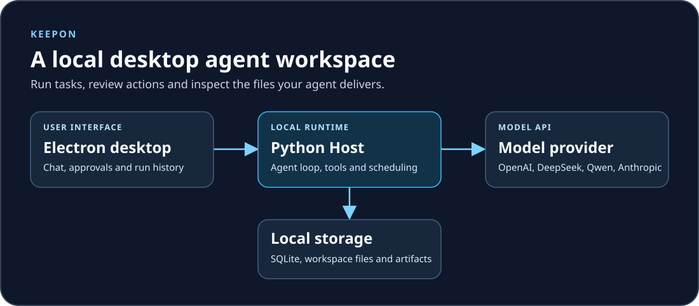

# KeepOn

**在桌面上运行、审批和追踪 AI Agent 任务。**

KeepOn 是一个本地运行的 AI Agent 工作台。你可以把多步任务交给 Agent，在桌面端审批敏感操作，并在任务完成后查看运行记录和交付文件。桌面端使用 Electron，任务和工具由 Python Host 管理。使用云端模型时，Host 会向你配置的模型服务发送请求。

[快速开始](#快速开始) · [首次使用](#首次使用) · [开发与验证](#开发与验证) · [反馈问题](https://github.com/WeiboShang/KeepOn/issues)



## 功能

- **执行和追踪任务**。支持流式对话、计划模式、工具调用、运行检查点、中断恢复和用量统计。
- **审批和验收**。审阅敏感工具调用，为任务定义验收条件，检查交付文件与结构化结果，并按需人工签收。
- **自动化和交付**。支持一次性、间隔和 Cron 调度。可在桌面端预览或下载 Agent 发布的文件。
- **扩展和知识管理**。支持 Skill、MCP、跨会话搜索、项目 Wiki 和长期记忆。候选知识经过审核后才会进入模型上下文。
- **桌面操作**。macOS Helper 支持观察应用、截图、点击、输入和滚动。启用时需要相应的系统权限。

## 快速开始

### Windows 桌面端

准备 Git、Python 3.12（安装时启用 `py` 启动器）以及 Node.js 20 或更新版本（含 npm）。在 PowerShell 中运行：

```powershell
git clone https://github.com/WeiboShang/KeepOn.git
cd KeepOn
.\scripts\start.ps1
```

首次运行会安装依赖并从 `backend/.env.example` 生成本地配置。脚本会一起启动桌面端和 Host，并为验收操作生成本次会话的临时凭据。如果 PowerShell 阻止本地脚本，可在当前窗口执行 `Set-ExecutionPolicy -Scope Process Bypass` 后重试。

### 首次使用

1. 打开桌面端的「设置」，选择 OpenAI、DeepSeek、Qwen 或 Anthropic，填写模型和 API 密钥，再测试连接。
2. 新建对话，输入一个小任务，例如「列出工作目录里的文件，并把清单保存为 Markdown」。
3. 在界面中处理审批，然后到「运行记录」查看执行过程，或到「交付物」打开已发布文件。

也可在本地 `backend/.env` 配置模型。以下以 Qwen 为例：

```dotenv
KEEPON_PROVIDER=qwen
KEEPON_MODEL=qwen-plus
KEEPON_API_KEY=
KEEPON_BASE_URL=https://dashscope.aliyuncs.com/compatible-mode/v1
```

在本地填入自己的密钥。仓库中的 [配置模板](backend/.env.example) 列出了常用变量。

## 数据与平台支持

- 新安装的运行数据默认位于 `backend/.keepon/`，包括数据库、设置和交付物。Agent 工作目录是 `backend/workspace/`。可用 `KEEPON_DATA_DIR` 和 `KEEPON_WORKSPACE_DIR` 覆盖。
- 用户级 Skill 默认位于 `~/.keepon/skills/`，可用 `KEEPON_USER_SKILLS_DIR` 覆盖。旧版用户升级时请将环境变量改用 `KEEPON_` 前缀。保留旧数据时，将 `KEEPON_DATA_DIR` 指向原目录，并按需设置 `KEEPON_DATABASE_NAME`（数据库文件名）和 `KEEPON_LEGACY_CREDENTIAL_SERVICE`（原凭据服务标识）。
- 模型密钥可放在本地 `.env`，也可由桌面应用交给 macOS Keychain 或 Windows DPAPI 保护。真实配置、数据库、工作文件和构建产物均在 [.gitignore](.gitignore) 中排除。
- 电脑操作仅由 macOS Helper 提供。在缺少工作区隔离的平台上，要求隔离的 Shell 或 MCP 进程会被拒绝启动。仅在信任 MCP Server 时才考虑显式授权宿主机访问。
- 搜索默认使用 DuckDuckGo。配置 `KEEPON_TAVILY_API_KEY` 后，自动模式优先使用 Tavily。HTTP 工具默认拦截私网访问。

## 开发与验证

Host 默认监听 `127.0.0.1:8765`，提供 `GET /health`、`WS /rpc`、截图读取和交付物下载。建议用启动脚本联调。如果分别启动 Host 和桌面端，两个进程须共享同一个至少 32 字节的随机 `KEEPON_ACCEPTANCE_TOKEN` 才能执行受保护的验收操作。自定义端口时，给两个进程设置相同的 `KEEPON_PORT`，并同步更新桌面端的 `VITE_RPC_URL`。

在项目根目录执行：

```powershell
cd backend
.\.venv\Scripts\python -m pip install -r requirements-dev.txt
.\.venv\Scripts\python -m pytest
.\.venv\Scripts\ruff check .

cd ..\desktop
npm test
npm run build
```

### macOS Computer Helper

在 macOS 上安装 Swift 工具链，再从项目根目录构建并测试：

```bash
cd native/macos-computer-helper
swift build -c release
swift test
```

在 Host 环境中设置 `KEEPON_COMPUTER_ENABLED=true`，并在 macOS 系统设置中授予辅助功能和屏幕录制权限。

## 源码导读

| 路径 | 职责 |
| --- | --- |
| [`backend/keepon`](backend/keepon) | Host、Agent 循环、工具、审批、持久化 |
| [`desktop/src`](desktop/src) | 桌面工作台、运行记录、设置和验收 |
| [`desktop/electron`](desktop/electron) | 桌面窗口、通知和受保护的本地调用 |
| [`native/macos-computer-helper`](native/macos-computer-helper) | macOS 应用观察和电脑操作 |
| [交付验收设计](docs/delivery-acceptance-design.md) | 任务规则、验收状态和权限边界 |

遇到问题时，可以在 [GitHub Issues](https://github.com/WeiboShang/KeepOn/issues) 提交复现步骤、操作系统版本和经过脱敏的错误信息。
